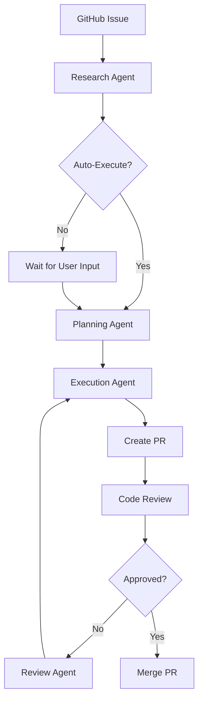

# Agent Architecture

This document describes the AI agent system that powers Async's automated code development workflow. The system uses multiple specialized agents working together to research, plan, execute, and review coding tasks.

## Overview

Async employs a multi-agent architecture where different AI models handle specific aspects of the development workflow:

- **Research Agent**: Analyzes codebases and gathers requirements
- **Planning Agent**: Breaks down tasks into executable subtasks  
- **Execution Agent**: Implements code changes using Claude Code
- **Review Agent**: Handles code review feedback and revisions

## Agent Types

### 1. Research Agent (`ResearchAgentMetadata`)

**Purpose**: Analyzes the codebase and task requirements to generate clarifying questions and structured task summaries.

**Model**: Google Gemini 2.5 Pro
**Tools**: 
- `ListFiles` - Explore repository structure
- `ReadFile` - Examine source code files
- `GitGrep` - Search for patterns across the codebase

**Workflow**:
1. Receives task description and project context
2. Analyzes repository structure and relevant files
3. Generates clarifying questions for ambiguous requirements
4. Creates structured task summary for execution

**Output**: `TaskResearchOutput` with clarifying questions and task analysis

### 2. Planning Agent (Claude Code in Plan Mode)

**Purpose**: Breaks down researched tasks into executable subtasks with clear implementation steps.

**Model**: Claude Opus 4.1
**Mode**: Plan mode (no file modifications)

**Workflow**:
1. Receives task description and requirements
2. Analyzes codebase structure and dependencies
3. Creates detailed breakdown of implementation steps
4. Generates `ASYNC_PLAN_BREAKDOWN.json` with subtask definitions

**Output**: `GeneratedSubtasks` containing structured subtask list

### 3. Execution Agent (`ClaudeCodeAgent`)

**Purpose**: Implements code changes for individual subtasks using Claude Code SDK.

**Model**: Claude Code (default model)
**Tools**: Read, Write, Bash
**Permission Mode**: `acceptEdits` (auto-accepts file changes)

**Key Features**:
- Automatic CLAUDE.md generation for project context
- Isolated execution environment per subtask
- Git integration for commit tracking
- Error handling and retry logic

**Workflow**:
1. Receives subtask with implementation steps
2. Analyzes existing code and previous subtask commits
3. Implements required changes following best practices
4. Runs tests and fixes any failures
5. Commits changes with descriptive message

### 4. Review Agent (Chat Agent)

**Purpose**: Handles code review feedback and creates revision subtasks.

**Model**: Configurable (OpenAI/Anthropic/Google)
**Tools**: Various analysis and communication tools

**Workflow**:
1. Processes review comments from developers
2. Analyzes requested changes in context
3. Creates new subtasks to address feedback
4. Triggers re-execution with updated requirements

## Agent Communication

### Task Flow



### Data Models

**Task**: Core task entity with description, requirements, and status
**Subtask**: Individual implementation step with title, description, and commit hash
**Project**: Repository metadata and configuration
**PullRequest**: Generated PR with links to task and subtasks

## Cloud Execution

### Google Cloud Run Jobs

Each agent type runs in isolated Google Cloud Run jobs:

- **`research-task`**: Research agent analysis
- **`execute-task`**: Planning and execution agents
- **`revise-task`**: Review agent for handling feedback
- **`index-project`**: Repository setup and indexing

### Job Configuration

```python
# Example job execution
await execute_task_async(
    org_id="org_123",
    task_id="task_456", 
    is_dev=False
)
```

### Environment Setup

Each job:
1. Clones repository to ephemeral environment
2. Sets up project dependencies
3. Configures agent with appropriate tools and permissions
4. Executes agent workflow
5. Pushes changes and updates database
6. Cleans up environment

## Agent Configuration

### System Prompts

Agents use specialized system prompts for their roles:

- **Research**: `RESEARCH_TASK_PROMPT` - Focus on analysis and question generation
- **Execution**: `EXECUTE_TASK_PROMPT` + `EXECUTE_TASK_SYSTEM_PROMPT` - Implementation guidelines
- **Planning**: `GENERATE_SUBTASKS_PROMPT` - Task breakdown instructions

### Model Selection

```python
# Research Agent
model = ChatGoogleGenerativeAI(model="gemini-2.5-pro")

# Planning Agent  
model = "claude-opus-4-1-20250805"
permission_mode = "plan"

# Execution Agent
model = "claude-code-default"  # Latest Claude Code model
permission_mode = "acceptEdits"
```

### Tool Access

Agents have access to different tool sets based on their role:

- **Research**: Read-only filesystem and git tools
- **Planning**: Analysis tools, no file modifications
- **Execution**: Full read/write access, bash commands
- **Review**: Communication and analysis tools

## Error Handling

### Retry Logic

```python
@retry(
    reraise=True, 
    stop=stop_after_attempt(3),
    retry=retry_if_exception_type((ProcessError, FileNotFoundError))
)
async def _generate_subtasks_async(...):
    # Agent execution with automatic retry
```

### Failure Recovery

- Task status tracking (`EXECUTING`, `FAILED`, `COMPLETED`)
- Subtask-level error isolation
- Automatic cleanup of ephemeral environments
- Detailed logging for debugging

## Security & Isolation

### Sandboxed Execution

- Each task runs in isolated Google Cloud Run container
- Ephemeral file systems with automatic cleanup
- No persistent state between executions
- Limited network access and resource constraints

### Permission Management

- GitHub App permissions for repository access
- Scoped access tokens for API operations
- Read-only access for research agents
- Controlled write access for execution agents

## Monitoring & Observability

### Logging

```python
logger = logging.getLogger(__name__)
logger.info(f"Starting execute_task job with params: org_id={org_id}, task_id={task_id}")
```

### Status Tracking

- Real-time task and subtask status updates
- Commit hash tracking for change attribution
- Diff file generation for code review
- Pull request integration for workflow completion

### Metrics

- Task completion rates
- Agent execution times
- Error rates by agent type
- Resource utilization per job

## Development & Testing

### Local Development

```bash
# Run agent locally
python -m src.execute_task

# Environment variables
export ORG_ID="org_123"
export TASK_ID="task_456"
export ANTHROPIC_API_KEY="..."
```

### Testing

```bash
# Run agent tests
python -m pytest src/tests/

# Test specific agent
python -m pytest src/tests/test_research_agent.py
```

## Best Practices

### Agent Design

1. **Single Responsibility**: Each agent handles one aspect of the workflow
2. **Stateless Execution**: No dependencies on previous runs
3. **Error Isolation**: Failures don't cascade between agents
4. **Structured Output**: Use Pydantic models for agent responses

### Code Quality

1. **Linting Integration**: Agents run linters and fix issues
2. **Test Execution**: Verify changes don't break existing functionality  
3. **Incremental Changes**: Small, focused commits per subtask
4. **Documentation**: Generate and update relevant documentation

### Performance

1. **Parallel Execution**: Independent subtasks can run concurrently
2. **Caching**: Reuse analysis between similar tasks
3. **Resource Limits**: Prevent runaway executions
4. **Cleanup**: Automatic environment teardown

## Future Enhancements

### Planned Features

- **Multi-language Support**: Specialized agents for different programming languages
- **Advanced Planning**: Dependency analysis and parallel execution planning
- **Learning Integration**: Agent improvement based on review feedback
- **Custom Tools**: Project-specific tool integration

### Research Areas

- **Agent Collaboration**: Better coordination between agent types
- **Context Preservation**: Maintaining context across long task sequences
- **Quality Metrics**: Automated code quality assessment
- **User Preferences**: Learning developer coding styles and preferences

---

*This agent system enables Async to provide intelligent, automated code development while maintaining high quality standards and developer control over the process.*
